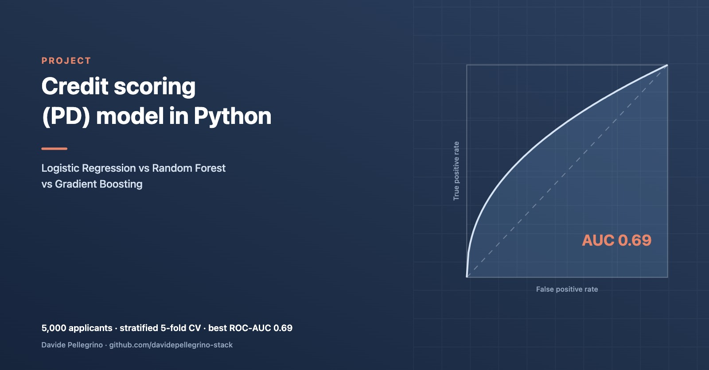

# Credit Scoring Model

[](https://github.com/davidepellegrino-stack/credit-scoring-model/actions/workflows/tests.yml)



A full machine learning pipeline for credit default prediction, built with scikit-learn. Trains and compares three models — Logistic Regression, Random Forest, and Gradient Boosting — with cross-validation, ROC-AUC evaluation, feature importance analysis, and publication-quality visualizations.

Built as part of a self-directed quantitative finance project alongside M2 Financial Economics studies at Université Paris 1 Panthéon-Sorbonne.

## Data: Home Credit (real loans)

The upgrade path for this repo is real data. `src/data_home_credit.py` downloads, caches (in the git-ignored `data/home_credit/`) and validates the application, bureau and previous-application tables of the **Home Credit Default Risk** dataset (Home Credit Group, Kaggle competition, 2018). Kaggle needs credentials, so the script fetches the same tables from a public Hugging Face mirror (`mohameddhameem/home-credit-default-risk`) for convenience. Raw data is never committed.

```bash
python src/data_home_credit.py
```

Checked on the actual download:

| Table | Rows | Notes |
|---|---|---|
| `application_train` | 307,511 | 123 columns, 24,825 defaults, **8.07% default rate** |
| `application_test` | 48,744 | target held out by the competition |
| `bureau` | 1,716,428 | credits reported by other lenders, 305,811 applicants |
| `previous_application` | 1,670,214 | earlier Home Credit applications (2 shards), 338,857 applicants |

`TARGET = 1` is Home Credit's "payment difficulties" flag: a late payment of more than X days on at least one of the first Y instalments (X and Y are not disclosed). It is a default-like event within an observation window, not a Basel 90-days-past-due default. The mirror adds an `application_date` column (2018-01-01 to 2020-12-31) that is not in the Kaggle original; it is treated as a synthetic timestamp and only used for an out-of-time split. Schema checks cover required columns, unique IDs, binary target and sign conventions.

## Results on real loans

```bash
python src/run_home_credit.py
```

Stratified 80/20 split (246,008 train / 61,503 test, seed 42), 8.07% default rate. The baseline features come from the application form only (`src/features_home_credit.py`): age, employment length (the `365243` "not employed" sentinel becomes NaN plus a flag), credit/income, annuity/income, goods/credit, credit term, income per family member, the three `EXT_SOURCE` scores and their mean/min/product/missing count, plus seven categoricals. Missing values: median imputation with missing-indicators for Logistic Regression and Random Forest, native NaN handling for gradient boosting; imputers are fitted inside the pipeline, on training data only.

Application-form features only:

| Model | Test AUC | Avg Precision | Brier |
|---|---|---|---|
| Logistic Regression | 0.746 | 0.233 | 0.0684 |
| Random Forest | 0.749 | 0.237 | 0.0685 |
| Gradient Boosting (HistGB) | **0.764** | 0.254 | 0.0673 |

### Adding credit history: bureau and previous applications

`src/features_history.py` collapses two one-to-many tables to one row per applicant: `bureau` (credits reported by other lenders: counts of active/closed/bad-debt credits, overdue days and amounts, active debt-to-limit, oldest and latest credit age) and `previous_application` (earlier Home Credit applications: approved/refused/cancelled counts, refusal share, approved amounts, credit-to-application ratio, time since last decision). Rows dated after the application are dropped. 85.7% of loans have bureau history and 94.6% have earlier applications; applicants without history get count features of 0 and a `has_*` flag, while ratios stay missing and are imputed inside the pipeline. Money amounts are `log1p`-transformed and the debt-to-limit ratio is capped at 2.

Same split, same models, with and without the 29 history features (paired bootstrap over the test set, 300 resamples):

| Model | AUC, application only | AUC, + history | Gain (95% CI) |
|---|---|---|---|
| Logistic Regression | 0.746 | 0.761 | +0.014 (0.012 to 0.017) |
| Random Forest | 0.749 | 0.755 | +0.006 (0.005 to 0.009) |
| Gradient Boosting (HistGB) | 0.764 | **0.773** | +0.009 (0.007 to 0.011) |

The gain is real but modest (about one AUC point), and largest for the linear model, which cannot build these interactions itself. Brier scores barely move (HistGB 0.0673 to 0.0667) against 0.0742 for a constant prediction at the base rate, so the PDs are sharper but not yet calibrated for ECL use. The bootstrap interval only reflects test-set sampling, not the choice of split or hyperparameters; the installment, POS-cash and credit-card tables are not used.

### Rank-ordering metrics: Gini, KS and decile gains

`src/metrics.py` adds the measures credit-risk teams quote next to AUC: Gini = 2·AUC − 1, the KS statistic (largest gap between the score distributions of defaulters and non-defaulters, i.e. max TPR − FPR) and a gains/lift table over ten equal-size bins ranked by predicted PD. Test set, all six model/feature combinations:

| Features | Model | AUC | Gini | KS |
|---|---|---|---|---|
| Application only | Logistic Regression | 0.746 | 0.492 | 0.367 |
| Application only | Random Forest | 0.749 | 0.498 | 0.368 |
| Application only | Gradient Boosting | 0.764 | 0.528 | 0.395 |
| + Bureau & previous | Logistic Regression | 0.761 | 0.521 | 0.384 |
| + Bureau & previous | Random Forest | 0.755 | 0.511 | 0.379 |
| + Bureau & previous | Gradient Boosting | **0.773** | **0.546** | **0.409** |

Decile table for the champion (HistGB with history); decile 1 holds the 10% of loans with the highest predicted PD, and the overall default rate is 8.07%:

| Decile | Default rate | Mean PD | Lift | Cumulative share of defaults |
|---|---|---|---|---|
| 1 | 29.1% | 28.0% | 3.60 | 36.0% |
| 2 | 15.1% | 14.7% | 1.86 | 54.6% |
| 3 | 10.2% | 10.1% | 1.27 | 67.3% |
| 4 | 7.3% | 7.5% | 0.90 | 76.4% |
| 5 | 6.1% | 5.8% | 0.75 | 83.9% |
| 6 | 4.3% | 4.5% | 0.54 | 89.2% |
| 7 | 3.2% | 3.6% | 0.39 | 93.2% |
| 8 | 2.6% | 2.8% | 0.32 | 96.4% |
| 9 | 1.7% | 2.2% | 0.22 | 98.6% |
| 10 | 1.2% | 1.4% | 0.15 | 100.0% |

The riskiest decile defaults 3.6 times as often as average and holds 36% of all defaults; the top three deciles hold 67%. Default rates fall monotonically. Mean PD tracks the observed rate closely in every decile, with a slight overestimate in the safest deciles (e.g. 2.2% vs 1.7% in decile 9); calibration is checked in the next section. The table is also written to `outputs/tables/home_credit_deciles.csv`.

### Calibration: are the PDs real probabilities?

IFRS 9 expected credit loss multiplies PD by LGD and EAD, so the PD must match observed default frequencies, not just rank loans. `src/calibration.py` and `src/run_calibration.py` test this for the champion. The champion is refit on 75% of the training loans (184,506); Platt scaling (logistic regression on logit of the score) and isotonic regression are fitted on the remaining 25% (61,502 loans); the 61,503-loan test set is only used for the comparison below.

| Version | Brier | Log loss | ECE | Mean PD − default rate |
|---|---|---|---|---|
| Raw HistGB | 0.06680 | 0.24157 | 0.00245 | −0.00006 |
| Platt scaling | 0.06680 | 0.24155 | 0.00221 | −0.00052 |
| Isotonic | 0.06685 | 0.24168 | 0.00380 | −0.00054 |

ECE is the loan-weighted mean gap between mean PD and observed default rate over ten equal-count bins. The result is that the raw gradient-boosting PDs are already well calibrated: the model is trained with log loss and no class weights, so its portfolio mean PD matches the default rate almost exactly and ECE is about 0.25 percentage points. Platt scaling changes nothing material and isotonic regression is slightly worse (it adds step-function noise), so I keep the raw PDs. The one visible bias is the one the decile table hinted at: the two safest bins are overestimated (bin 1: mean PD 1.36% vs 1.06% observed; bin 2: 2.12% vs 1.69%), which is small in absolute terms but matters for low-risk stage 1 ECL. `python src/run_calibration.py` (about 35 s once the data is cached) writes the reliability-curve PNG to `outputs/figures/home_credit_reliability.png` and the tables `home_credit_calibration.csv` and `home_credit_reliability.csv` to `outputs/tables/`.

### WoE / Information Value scorecard

Banks usually ship the PD model as a points scorecard, because every bin and its points can be read, challenged and audited. `src/scorecard.py` bins each variable (quantile pre-bins merged until the bad rate is monotone and every bin holds at least 5% of loans; missing values get their own bin; rare categories pool into "other"), computes the Weight of Evidence (ln of good share over bad share, smoothed by 0.5) and the Information Value, fits a logistic regression on the WoE values and rescales the log-odds to points: 600 points at 50:1 odds of good, 20 points to double the odds (PDO). Bins are fitted on the training loans only. `python src/run_scorecard.py` (about 20 s once the data is cached) keeps the 15 variables with the highest IV (all at least 0.02) and writes `home_credit_iv.csv`, `home_credit_scorecard_points.csv` and `home_credit_scorecard_metrics.csv` to `outputs/tables/`.

Information value on the training loans (reading: 0.1-0.3 medium, 0.3-0.5 strong, above 0.5 very strong, often a sign of a dominant variable to check for leakage):

| Variable | IV |
|---|---|
| ext_source_mean | 0.598 |
| ext_source_min | 0.465 |
| EXT_SOURCE_3 | 0.323 |
| EXT_SOURCE_2 | 0.302 |
| ext_source_prod | 0.252 |
| EXT_SOURCE_1 | 0.146 |
| employed_years | 0.112 |
| age_years | 0.088 |

The three external scores (anonymised third-party scores supplied with the data) dominate, so the high IV of their aggregates is expected rather than leakage. They are strongly correlated with each other, so their IV is not additive; the logistic regression shares the weight among them.

Test-set result (61,503 loans): AUC 0.742, Gini 0.483, KS 0.358, against Gini 0.546 and KS 0.409 for the gradient-boosting champion. The scorecard gives up about 0.06 Gini for a model that can be audited line by line. Scores run from 471 to 644 (median 569); the default rate falls monotonically across score deciles, from 25.4% in the lowest-score decile to 1.4% in the highest.

### Out-of-time check

A bank validates a PD model on loans originated after the ones it was fitted on. `src/run_out_of_time.py` (about 50 s once the data is cached) trains the champion (gradient boosting with bureau and previous-application history) on loans applied in 2018-2019 (205,007) and tests it on 2020 (102,504), next to the same model trained on a random sample of the same size and tested on the same 2020 loans.

| Training set | AUC | Gini | KS | Brier | Mean PD | Default rate |
|---|---|---|---|---|---|---|
| Out-of-time (2018-2019) | 0.7757 | 0.5514 | 0.4145 | 0.0662 | 8.07% | 7.98% |
| Random, same size | 0.7760 | 0.5519 | 0.4153 | 0.0661 | 8.07% | 7.98% |

The two are indistinguishable, and AUC is stable by quarter (0.772 to 0.778). This is not evidence that the model is stable over time. The `application_date` column exists only in the Hugging Face mirror (the Kaggle original has no dates), its rank correlation with `SK_ID_CURR` is 1.00000 (dates were assigned in id order), and the default rate is flat at 7.9-8.4% in all twelve quarters. So the split is a mechanical test of the pipeline (no leakage through ids or dates, no dependence on sample size) and the numbers here cannot show drift. A real OOT test needs genuine origination dates, for example the Freddie Mac loan-level data planned for the mortgage extension.

## Macro data for IFRS 9 (work in progress)

`ifrs9/fred.py` downloads ten US macro and bank-credit series from FRED (unemployment, real GDP, fed funds, 10y yield, CPI, Case-Shiller, and the all-bank delinquency / charge-off rates for credit cards, consumer loans and mortgages), caches them under `data/fred/` (git-ignored) and aligns them to calendar quarters. Monthly and daily series are averaged within the quarter and left missing if the quarter is incomplete; quarterly series are kept as published. It also builds the regressors for the satellite model (GDP growth y/y, 4-quarter change in unemployment, inflation, house-price growth, term spread). Run `python ifrs9/fred.py` for the coverage table. Card delinquency starts in 1991Q1 and charge-offs in 1985Q1; the unemployment rate for 2025Q4 is missing because October 2025 was never published. These are US bank-portfolio series, not Home Credit's own book, so the satellite model next in line is a macro-to-credit-cycle link, not a fit to the Home Credit loans (the mirror's dates carry no cycle).

### Macro satellite model (`ifrs9/satellite.py`)

The satellite model links the all-US-bank credit-card charge-off rate to the economy. It is an autoregressive model on the logit of the rate with two macro drivers:

`logit(c_t) = a + rho * logit(c_(t-1)) + b_u * d_unrate_4q_t + b_g * gdp_growth_yoy_t + e_t`

Estimated by OLS with Newey-West standard errors (4 lags, implemented in numpy and unit-tested against the textbook formulas). Quarters with a missing regressor are dropped, not interpolated. The COVID window 2020Q1-2021Q4 is excluded from the fit: stimulus and payment holidays lowered charge-offs while unemployment jumped, and including it removes the unemployment effect (full-sample b_u = 0.009, t = 0.5). That exclusion is a modelling choice; `python ifrs9/run_satellite.py` prints both fits.

| 1985Q2-2026Q2, n = 156 | coefficient | Newey-West SE | t |
|---|---|---|---|
| constant | -0.512 | 0.092 | -5.6 |
| lagged logit (rho) | 0.854 | 0.026 | 33.2 |
| change in unemployment, 4 quarters (pp) | 0.047 | 0.011 | 4.3 |
| real GDP growth y/y (pp) | -0.008 | 0.006 | -1.4 |

A permanent +1 pp rise in the four-quarter unemployment change multiplies the long-run charge-off rate by about 1.38 (exp(0.047 / (1 - 0.854))). GDP growth has the expected sign but is not significant once unemployment is in the model.

Out-of-sample check: expanding-window one-step-ahead forecasts from 2005Q1 (77 quarters, COVID quarters not scored). RMSE is 0.269 pp for the model against 0.344 pp for the AR(1)-only benchmark (ratio 0.78; Diebold-Mariano t = 2.2, p = 0.03), so the macro terms add real, if modest, forecasting power.

Limits: residuals still show autocorrelation (Ljung-Box(4) p < 0.01, Durbin-Watson 1.84), so the standard errors rely on the HAC correction and the model is a transparent baseline, not a final forecasting tool. The series describes US bank card portfolios, not the Home Credit book. Scenario paths (B3) and the mapping to loan-level PDs (B4) come next.

## Synthetic demo (used by the unit tests)

The original pipeline below (`python src/main.py`) runs on the synthetic generator; its numbers are not real-world performance.

### Synthetic-data results

| Model | CV AUC | Test AUC | Sensitivity | Specificity |
|---|---|---|---|---|
| Logistic Regression | 0.691 ± 0.012 | 0.669 | 0.548 | 0.694 |
| Random Forest | 0.680 ± 0.007 | 0.643 | 0.421 | 0.768 |
| Gradient Boosting | 0.664 ± 0.005 | 0.646 | 0.404 | 0.787 |

Logistic Regression achieves the best ROC-AUC, consistent with established findings in credit scoring literature that interpretable linear models are competitive when features are well-engineered.

## Features

**10 numeric:** age, income, employment years, loan amount, loan duration, loan-to-income ratio, existing debts, credit utilization, number of previous loans, months since last default.

**3 categorical:** loan purpose, housing status, employment type.

**Target:** binary default indicator (1 = default within loan term).

Dataset: 5,000 synthetic applicants, ~26% default rate, generated with realistic correlations between applicant characteristics and default probability.

## Pipeline Architecture

Each model uses a full sklearn `Pipeline` to prevent data leakage:

```
ColumnTransformer
  ├── Numeric features  → StandardScaler
  └── Categorical       → OneHotEncoder (handle_unknown='ignore')
        ↓
  Classifier (LR / RF / GBM)
```

## Outputs

**7 charts:**

| Chart | Description |
|---|---|
| `eda.png` | Default rate by LTI bucket, employment type, income distribution, credit utilization |
| `roc_curves.png` | ROC curves for all 3 models overlaid |
| `precision_recall.png` | Precision-Recall curves |
| `confusion_matrices.png` | Confusion matrices (% of test set) |
| `feature_importance_*.png` | Top 15 features per model |
| `score_distribution.png` | Predicted probability distribution by true class |

**3 tables:** `model_comparison.csv`, `cv_results.csv`, `feature_importance_*.csv`

## Quick Start

```bash
git clone https://github.com/davidepellegrino-stack/credit-scoring-model.git
cd credit-scoring-model
pip install -r requirements.txt
python src/main.py
```

### Tests

```bash
pip install pytest
pytest -q
```

The suite checks the data generator (schema, ranges, reproducibility, direction of known risk drivers) and the modelling pipeline (stratified split, no target leakage, unseen categories at scoring time, AUC above a floor). It runs on every push via GitHub Actions.

## Project Structure

```
credit-scoring-model/
├── src/
│   ├── config.py           # All parameters and paths
│   ├── generate_data.py    # Synthetic dataset generator (tests)
│   ├── data_home_credit.py # Home Credit download, cache, validation
│   ├── features_home_credit.py # Application-form features
│   ├── features_history.py # Bureau and previous-application aggregates
│   ├── run_home_credit.py  # LR / RF / GBM on the real loans, with and without history
│   ├── calibration.py      # ECE, reliability table, Platt and isotonic calibrators
│   ├── run_calibration.py  # Calibration of the champion on a held-out split
│   ├── scorecard.py        # WoE binning, Information Value, points scorecard
│   ├── run_scorecard.py    # Scorecard on the real loans vs the champion
│   ├── out_of_time.py      # Time split, date/id diagnostic, per-quarter table
│   ├── run_out_of_time.py  # Train 2018-2019, test 2020
│   ├── models.py           # sklearn pipelines + evaluation
│   ├── visualizations.py   # All charts
│   └── main.py             # End-to-end pipeline
├── ifrs9/
│   ├── fred.py             # FRED download, quarterly alignment, macro regressors
│   ├── satellite.py        # macro satellite model: ARX logit, Newey-West SEs, OOS check
│   └── run_satellite.py    # fit, diagnostics and out-of-sample scores
├── tests/                  # pytest suite (data + models)
├── data/                   # Generated dataset (CSV)
├── outputs/
│   ├── figures/            # PNG charts
│   └── tables/             # CSV result tables
├── requirements.txt
└── README.md
```

## Methodology Notes

**Why three models?** Logistic Regression is the industry standard in retail credit (interpretable, passes regulatory scrutiny under Basel III / IFRS 9). Random Forest and Gradient Boosting capture non-linear interactions and are used in challenger model frameworks. Comparing all three mirrors real bank model validation practice.

**Evaluation beyond accuracy:** In credit scoring, the cost of a false negative (missed default) is typically 4-5x the cost of a false positive (rejected good customer). ROC-AUC and the sensitivity/specificity tradeoff are therefore more informative than raw accuracy.

**Class weighting:** Logistic Regression and Random Forest use `class_weight="balanced"` to handle class imbalance without resampling, which can introduce bias in probability estimates.

## Requirements

- Python 3.9+
- scikit-learn, pandas, numpy, scipy, matplotlib, seaborn

## Author

Davide Pellegrino · M2 Financial Economics, Université Paris 1 Panthéon-Sorbonne · [LinkedIn](https://www.linkedin.com/in/pellegrino-davide/)

Other projects: [Sanctions and privacy coins (M1 thesis)](https://github.com/davidepellegrino-stack/sanctions-privacy-coins) · [Portfolio risk analyzer](https://github.com/davidepellegrino-stack/portfolio-risk-analyzer)
