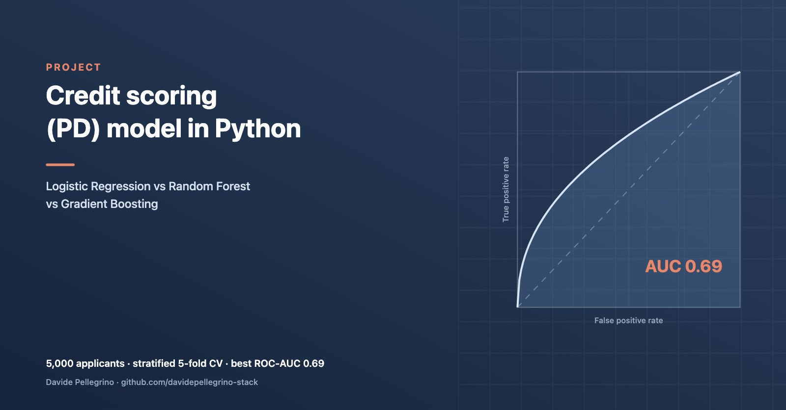

# Credit Scoring Model

[](https://github.com/davidepellegrino-stack/credit-scoring-model/actions/workflows/tests.yml)



A full machine learning pipeline for credit default prediction, built with scikit-learn. Trains and compares three models — Logistic Regression, Random Forest, and Gradient Boosting — with cross-validation, ROC-AUC evaluation, feature importance analysis, and publication-quality visualizations.

Built as part of a self-directed quantitative finance project alongside M2 Financial Economics studies at Université Paris 1 Panthéon-Sorbonne.

## Data: Home Credit (real loans)

The upgrade path for this repo is real data. `src/data_home_credit.py` downloads, caches (in the git-ignored `data/home_credit/`) and validates the application tables of the **Home Credit Default Risk** dataset (Home Credit Group, Kaggle competition, 2018). Kaggle needs credentials, so the script fetches the same tables from a public Hugging Face mirror (`mohameddhameem/home-credit-default-risk`) for convenience. Raw data is never committed.

```bash
python src/data_home_credit.py
```

Checked on the actual download:

| Table | Rows | Notes |
|---|---|---|
| `application_train` | 307,511 | 123 columns, 24,825 defaults, **8.07% default rate** |
| `application_test` | 48,744 | target held out by the competition |

`TARGET = 1` is Home Credit's "payment difficulties" flag: a late payment of more than X days on at least one of the first Y instalments (X and Y are not disclosed). It is a default-like event within an observation window, not a Basel 90-days-past-due default. The mirror adds an `application_date` column (2018-01-01 to 2020-12-31) that is not in the Kaggle original; it is treated as a synthetic timestamp and only used for an out-of-time split. Schema checks cover required columns, unique IDs, binary target and sign conventions.

The models below still run on the synthetic generator, which is kept for the unit tests; they are being moved to the real data next.

## Models

| Model | CV AUC | Test AUC | Sensitivity | Specificity |
|---|---|---|---|---|
| Logistic Regression | 0.691 ± 0.012 | 0.669 | 0.548 | 0.694 |
| Random Forest | 0.680 ± 0.007 | 0.643 | 0.421 | 0.768 |
| Gradient Boosting | 0.664 ± 0.005 | 0.646 | 0.404 | 0.787 |

Logistic Regression achieves the best ROC-AUC, consistent with established findings in credit scoring literature that interpretable linear models are competitive when features are well-engineered.

## Features

**10 numeric:** age, income, employment years, loan amount, loan duration, loan-to-income ratio, existing debts, credit utilization, number of previous loans, months since last default.

**3 categorical:** loan purpose, housing status, employment type.

**Target:** binary default indicator (1 = default within loan term).

Dataset: 5,000 synthetic applicants, ~26% default rate, generated with realistic correlations between applicant characteristics and default probability.

## Pipeline Architecture

Each model uses a full sklearn `Pipeline` to prevent data leakage:

```
ColumnTransformer
  ├── Numeric features  → StandardScaler
  └── Categorical       → OneHotEncoder (handle_unknown='ignore')
        ↓
  Classifier (LR / RF / GBM)
```

## Outputs

**7 charts:**

| Chart | Description |
|---|---|
| `eda.png` | Default rate by LTI bucket, employment type, income distribution, credit utilization |
| `roc_curves.png` | ROC curves for all 3 models overlaid |
| `precision_recall.png` | Precision-Recall curves |
| `confusion_matrices.png` | Confusion matrices (% of test set) |
| `feature_importance_*.png` | Top 15 features per model |
| `score_distribution.png` | Predicted probability distribution by true class |

**3 tables:** `model_comparison.csv`, `cv_results.csv`, `feature_importance_*.csv`

## Quick Start

```bash
git clone https://github.com/davidepellegrino-stack/credit-scoring-model.git
cd credit-scoring-model
pip install -r requirements.txt
python src/main.py
```

### Tests

```bash
pip install pytest
pytest -q
```

The suite checks the data generator (schema, ranges, reproducibility, direction of known risk drivers) and the modelling pipeline (stratified split, no target leakage, unseen categories at scoring time, AUC above a floor). It runs on every push via GitHub Actions.

## Project Structure

```
credit-scoring-model/
├── src/
│   ├── config.py           # All parameters and paths
│   ├── generate_data.py    # Synthetic dataset generator (tests)
│   ├── data_home_credit.py # Home Credit download, cache, validation
│   ├── models.py           # sklearn pipelines + evaluation
│   ├── visualizations.py   # All charts
│   └── main.py             # End-to-end pipeline
├── tests/                  # pytest suite (data + models)
├── data/                   # Generated dataset (CSV)
├── outputs/
│   ├── figures/            # PNG charts
│   └── tables/             # CSV result tables
├── requirements.txt
└── README.md
```

## Methodology Notes

**Why three models?** Logistic Regression is the industry standard in retail credit (interpretable, passes regulatory scrutiny under Basel III / IFRS 9). Random Forest and Gradient Boosting capture non-linear interactions and are used in challenger model frameworks. Comparing all three mirrors real bank model validation practice.

**Evaluation beyond accuracy:** In credit scoring, the cost of a false negative (missed default) is typically 4-5x the cost of a false positive (rejected good customer). ROC-AUC and the sensitivity/specificity tradeoff are therefore more informative than raw accuracy.

**Class weighting:** Logistic Regression and Random Forest use `class_weight="balanced"` to handle class imbalance without resampling, which can introduce bias in probability estimates.

## Requirements

- Python 3.9+
- scikit-learn, pandas, numpy, scipy, matplotlib, seaborn

## Author

Davide Pellegrino · M2 Financial Economics, Université Paris 1 Panthéon-Sorbonne · [LinkedIn](https://www.linkedin.com/in/pellegrino-davide/)

Other projects: [Sanctions and privacy coins (M1 thesis)](https://github.com/davidepellegrino-stack/sanctions-privacy-coins) · [Portfolio risk analyzer](https://github.com/davidepellegrino-stack/portfolio-risk-analyzer)
